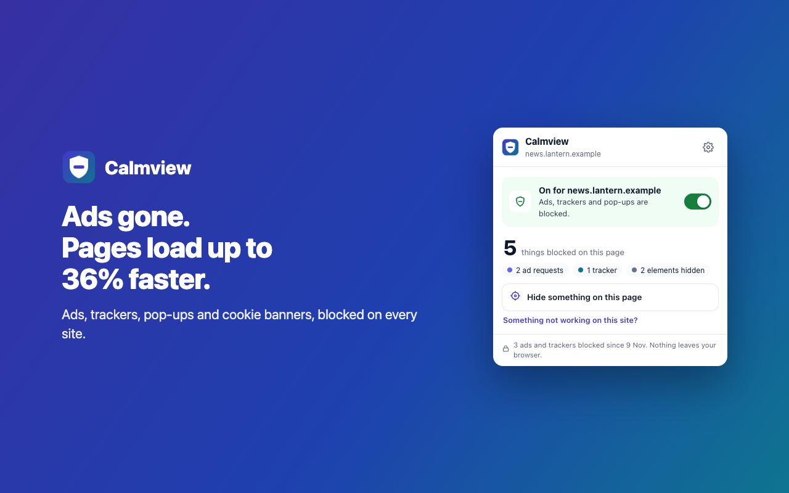

# Calmview

A fast, simple, private ad blocker for Chrome. Ads, trackers, pop-ups and cookie banners are blocked
on every site, YouTube included, with one switch per site and nothing leaving your browser.



## Why another ad blocker?

- **Faster pages.** Ads and trackers never download, so busy sites load faster and use less data.
  Clean sites stay just as quick, because blocking runs in Chrome's own engine.

  | Site | Without | With Calmview | Faster |
  | --- | --- | --- | --- |
  | BBC News | 9.4 s | 6 s | 36% |
  | The Independent | 11.7 s | 7.8 s | 33% |
  | GitHub | 16.3 s | 11.3 s | 31% |
  | Daily Mirror | 15.3 s | 12.1 s | 21% |

  Median of 5 loads, cache off, measured 8 Nov 2026 (`test/e2e/live.spec.ts`, "speed").
- **Simple.** One switch per site, one number, one "hide this" button. If a site misbehaves,
  "Something not working?" offers lighter blocking: ads stay out and the page is left alone.
- **YouTube.** Ad slots are removed before the player sees them; any ad that slips through is muted,
  sped up and skipped. Optional sponsor skipping (SponsorBlock) and Hide Shorts.
- **Safer.** Known malware and scam sites are stopped before they load, with a clear explanation.
- **Private.** No account, no server, no analytics. See [PRIVACY.md](PRIVACY.md).

## Build it

```bash
pnpm install
pnpm build          # downloads the filter lists on first build, compiles them, builds dist/
# chrome://extensions → Developer mode → Load unpacked → dist/
pnpm test           # unit tests
pnpm test:e2e       # headless end-to-end tests, every screen in light and dark
pnpm release        # fresh lists, version bump, all tests on the store build, zip in release/
```

## How it works

Filter lists are compiled at build time into Chrome `declarativeNetRequest` rulesets (plain-host
filters merged into a few rules), a cosmetic index injected as a user stylesheet, and per-site
scriptlets that run before the page's own scripts. Details in `src/lib/filters/` and `src/main/`.

## Licence and credits

GPLv3 (see [LICENSE](LICENSE)). Built on volunteer-run filter lists; see [CREDITS.md](CREDITS.md).

Support: support@sonarsystems.co.uk
